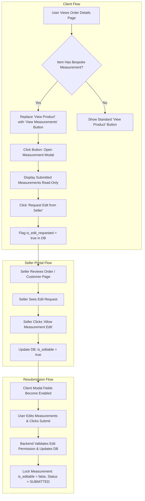

# Implementation Plan: Order Details, Status Synchronization & Bespoke Measurement Workflows

## Executive Summary
This document specifies the end-to-end implementation plan for synchronizing order status lifecycles, ensuring dynamic product data and images across the client portal, properly associating bespoke measurements with specific orders, and providing a customer-tailor measurement revision workflow between `apps/client` and `apps/seller`.

---

## 1. Problem Diagnosis & Architecture Gaps

### 1.1 Client Order Detail Page Displays Static Dummy Data
- **Root Cause**: In `packages/client-packages/client-modules/orders/repositories/order-repository.ts`, lines 285–336 contain fallback logic that sets hardcoded Unsplash images (`https://images.unsplash.com/...`), placeholder names `"Tailored Garment"`, and `"Standard"` properties.
- When `order_items` are created, they do not always pull the primary CDN URL from `product_media` (`productImagesTable`).
- If an order has custom tailoring specifications or variant attributes, they are lost or set to static fallbacks instead of being dynamically fetched.

### 1.2 Status Pipeline Desynchronization & Seller Button Failures
- **Visual Discrepancy**:
  - **Seller Portal Pipeline** displays 6 sequential stages: `PENDING` (Order Placed) -> `CONFIRMED` (Accepted) -> `PROCESSING` (Packed) -> `READY_TO_SHIP` (Ready for Shipment) -> `OUT_FOR_DELIVERY` (Out for Delivery) -> `COMPLETED` (Completed).
  - **Client Portal Timeline** displays a 4-stage static step map (`Order Confirmed` -> `Shipped` -> `Out For Delivery` -> `Delivered`). When the seller is in `CONFIRMED` or `PROCESSING`, the client timeline stays locked at stage 1 and does not visually align with seller updates.
- **"Advance Step Pipeline" Error**:
  - In `packages/modules/modules/orders/validations/update-order-status.schema.ts`:
    `remarks: z.string().min(1, "Remarks are required")`
  - In `packages/modules/modules/orders/hooks/use-order-inspector.tsx`:
    `updateOrderStatusClient(orderId, "ADVANCE")` is invoked without passing `remarks`.
  - Zod validation throws a 400 Bad Request error (`Remarks are required`), causing the status update to fail immediately.
- **"Cancel Order" Button**:
  - Suffers from the exact same missing remarks validation issue.

### 1.3 Seller Customer Page Measurement Association & Access Restrictions
- **Disconnection**: When a user customizes a product in `product-customize-view.tsx`, `submitOnlineCustomerMeasurementAction` creates a row in `customer_measurements` with `orderId: null`. During checkout (`order-creation-service.ts`), the newly placed order is never linked back to this measurement row.
- Consequently, in `customers-details.tsx`, `m.orderId` is null and cannot be linked to the order.
- **Business Rule Compliance**:
  - Ready-to-wear (RTW) orders (sizes XS, S, M, L, XL, XXL) must **not** show false measurements.
  - Seller **cannot** modify or delete user-stored online measurements.
  - Seller can **only** record new in-store measurements during walk-in atelier visits, associated with the customer's email.

### 1.4 Customer Measurement Revision Workflow
- Customers who submitted inaccurate measurements cannot currently view or correct them post-checkout.
- Required Flow:
  1. On `http://localhost:3000/account/orders/[id]`: if the order item is bespoke (has measurement), replace the "View product" button with a "View Measurements" button.
  2. Clicking opens a modal showing submitted measurements with fields **disabled** by default.
  3. Includes a "Request Edit from Seller" action.
  4. Once seller clicks "Allow Measurement Edit" in seller portal, the client modal fields become enabled for re-submission.
  5. Submitting updates the measurement in DB and locks it again.

---

## 2. Proposed Changes & Implementation Steps



### Module 1: Database Schema Expansion
- File: `packages/db/db/schema/customization/measurements.ts`
- Add columns to `customerMeasurementsTable`:
  - `isEditable: boolean("is_editable").default(false).notNull()`
  - `editRequested: boolean("edit_requested").default(false).notNull()`
  - `editRequestReason: text("edit_request_reason")`
  - `editRequestedAt: timestamp("edit_requested_at", { withTimezone: true })`
  - `lastEditedAt: timestamp("last_edited_at", { withTimezone: true })`

---

### Module 2: Client Order Dynamic Data Resolution (Image, Product, Properties)
- File: `packages/client-packages/client-modules/orders/repositories/order-repository.ts`
- Modify `getOrderDetail`:
  - Left join or query `orderItems` with `productsTable` and `productImagesTable` (where `isPrimary = true`).
  - Fallback logic:
    ```typescript
    const resolvedImage = item.imageUrl 
      || item.thumbnailUrl 
      || catalogProduct?.primaryImage 
      || catalogProduct?.thumbnailUrl 
      || "/images/placeholder-garment.png";
    ```
  - `itemName`: `item.productName || catalogProduct?.name || "Bespoke Garment"`
  - `productId`: `item.productId`
  - `orderProperties`: `item.variantName || (item.size ? `Size: ${item.size}` : "Bespoke Custom")`
  - Query `customerMeasurementsTable` for each `orderItemId` / `orderId` to attach:
    ```typescript
    hasMeasurement: boolean,
    measurementData: CustomerMeasurementRecord | null
    ```
- Modify `packages/client-packages/client-modules/orders/services/order-creation-service.ts`:
  - When saving `orderItems`, populate `imageUrl` from the catalog product / primary media if not provided in cart item.
  - Link any active bespoke measurements created for this product/cart session to `newOrder.id` and `createdItem.id`.

---

### Module 3: Status Pipeline Synchronization & Bug Fixes
- File: `packages/modules/modules/orders/validations/update-order-status.schema.ts`
  - Change `remarks` from strictly required to optional with sensible defaults:
    ```typescript
    export const updateOrderStatusBodySchema = z.object({
      action: z.enum(["ADVANCE", "CANCEL", "ACCEPT_RETURN", "REJECT_RETURN"]),
      remarks: z.string().optional().default(""),
    });
    ```
- File: `packages/modules/modules/orders/hooks/use-order-inspector.tsx`
  - In `handleAdvance()`: pass descriptive default remarks (e.g. `"Advancing pipeline step"`).
  - In `handleCancel()`: prompt for cancellation reason or pass `"Cancelled by seller"`.
- File: `packages/modules/modules/orders/repositery/update-order-status.repository.ts`
  - Ensure fallback remarks are saved to `orderStatusHistory.remarks`.
  - Validate transition:
    - `PENDING` -> `CONFIRMED`
    - `CONFIRMED` -> `PROCESSING`
    - `PROCESSING` -> `READY_TO_SHIP`
    - `READY_TO_SHIP` -> `OUT_FOR_DELIVERY`
    - `OUT_FOR_DELIVERY` -> `COMPLETED`
    - Any active state -> `CANCELLED`
- File: `packages/client-packages/client-modules/orders/repositories/order-repository.ts`
  - Update `buildTimeline`:
    - Synchronize the standard fulfillment stages with the seller pipeline:
      1. **Order Placed**: Active when `status in [PENDING, CONFIRMED, PROCESSING, READY_TO_SHIP, OUT_FOR_DELIVERY, COMPLETED]`
      2. **Accepted**: Active when `status in [CONFIRMED, PROCESSING, READY_TO_SHIP, OUT_FOR_DELIVERY, COMPLETED]`
      3. **Packed**: Active when `status in [PROCESSING, READY_TO_SHIP, OUT_FOR_DELIVERY, COMPLETED]`
      4. **Ready for Shipment / Shipped**: Active when `status in [READY_TO_SHIP, SHIPPED, OUT_FOR_DELIVERY, COMPLETED]`
      5. **Out for Delivery**: Active when `status in [OUT_FOR_DELIVERY, COMPLETED]`
      6. **Delivered / Completed**: Active when `status in [COMPLETED, DELIVERED]`
    - Add matching cancellation node if `order.status === "CANCELLED"`.

---

### Module 4: Measurement Association & Seller Customer Page Permissions
- File: `packages/modules/modules/customers/repository/customer.repository.ts`
  - In `getCustomerDetailsRepo`:
    - Include `orderNumber` in the measurement items join (`orders.orderNumber AS orderNumber`).
    - Distinguish between RTW orders (`size: SM/XL/etc.`) and Bespoke orders (`tailoringStage` / `measurementId`).
- File: `packages/modules/modules/customers/view/customers-details.tsx`
  - Clearly display order associations:
    - If bespoke: `Order #{orderNumber} (Custom Fit)`
    - If RTW: `Ready-to-Wear (Size: {size})` without measurement linkage.
  - Ensure measurements are read-only: **do not provide edit or delete controls for online customer measurements**.
  - Keep "Record First Measurement" / "Record" modal specifically for walk-in in-store measurements only.
  - Add "Allow Edit" action button for measurements where customer has requested changes (`editRequested === true`).

---

### Module 5: Client Order Page Measurement Modal & Revision API
- File: `packages/client-packages/client-modules/orders/components/order-status.tsx`
  - If `hasMeasurement && measurementData`:
    - Replace the "View product" button with a "View Measurements" button (`Ruler` icon).
    - Maintain existing UI styling and classes to strictly adhere to design rules.
  - Create a new modal component: `packages/client-packages/client-modules/orders/components/measurement-details-modal.tsx`:
    - Shows essential measurements and posture specifics.
    - Fields are disabled when `isEditable === false`.
    - If `isEditable === false` and `editRequested === false`: provides "Request Measurement Edit" button.
    - If `editRequested === true && !isEditable`: displays badge: `"Edit request sent to boutique seller. Awaiting approval."`
    - If `isEditable === true`: all inputs are enabled, and "Save & Submit Updated Measurements" button is active.
- Backend API Endpoints:
  - `POST /api/orders/[id]/measurements/request-edit`: Sets `editRequested = true`, `editRequestReason`.
  - `PATCH /api/orders/[id]/measurements`: Validates `isEditable === true`, saves new metrics, sets `isEditable = false`, `editRequested = false`.
  - `POST /api/seller/orders/[orderId]/measurements/allow-edit`: Seller API to toggle `isEditable = true`.

---

## 3. Verification & Testing Plan

### 3.1 Automated Tests
- Test file: `packages/modules/tests/order-pipeline-and-measurements.test.ts`
  - Test Zod validation for `updateOrderStatusBodySchema` with and without remarks.
  - Test order status advancement from `PENDING` -> `CONFIRMED` -> `PROCESSING` -> `READY_TO_SHIP` -> `OUT_FOR_DELIVERY` -> `COMPLETED`.
  - Test cancel order action and stock release.
  - Test measurement edit permission rules (user cannot update unless `isEditable === true`).
- Test file: `packages/client-packages/tests/client-order-dynamic-data.test.ts`
  - Test `OrderRepository.getOrderDetail` dynamic image and property resolution from `product_media` and `productsTable`.
  - Test timeline step generation synchronization with seller pipeline.

### 3.2 Manual Verification
- In client app (`localhost:3000`):
  1. Open `/account/orders/[id]` for both an RTW order and a Bespoke order.
  2. Verify correct product image and properties are displayed (no static placeholder).
  3. Verify Bespoke order displays "View Measurements" button instead of "View product".
  4. Click "View Measurements", verify fields are read-only and "Request Measurement Edit" is present.
  5. Click "Request Measurement Edit".
- In seller app (`localhost:3001` or seller route):
  1. Open the order in Orders inspector: click "Advance Step Pipeline" -> verify success without 400 error.
  2. Click "Cancel Order" on a test order -> verify success.
  3. Go to Customers page -> verify measurement is linked to the bespoke order with order number, and RTW order has no false measurement.
  4. Click "Allow Measurement Edit" on customer measurement.
- Back in client app:
  1. Reopen measurement modal -> verify fields are now editable.
  2. Edit a metric (e.g. chest circumference) and click "Submit".
  3. Verify modal locks again and seller sees updated measurement.
