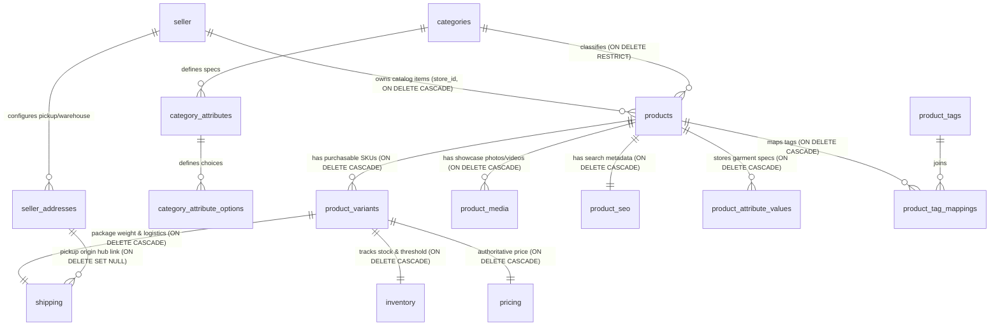
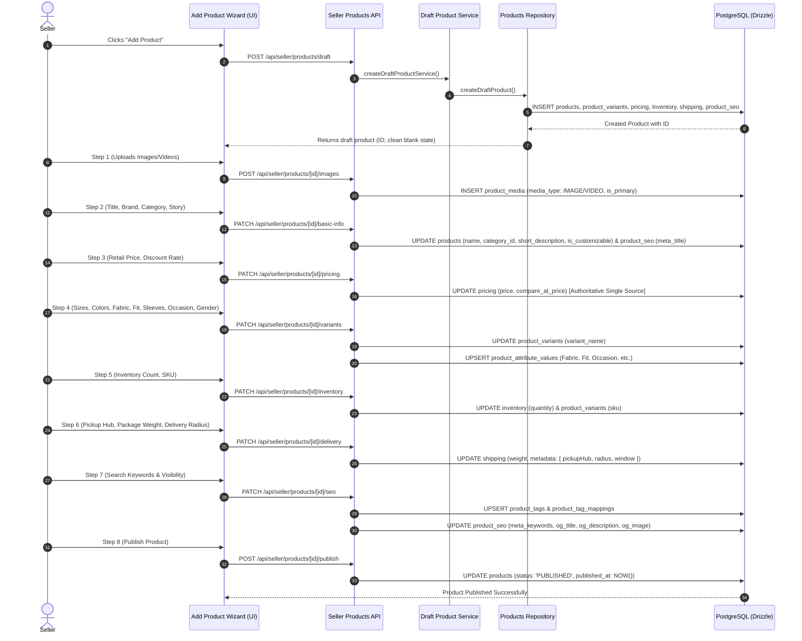

# Needlon Product Catalog, Inventory & Delivery Integration Plan

## 1. Executive Summary & Purpose

This document provides the definitive architectural specification and implementation roadmap for correcting the product catalog, variant pricing, inventory allocation, and fulfillment/pickup integrations across the Needlon Seller platform (`apps/seller`, `packages/db`, and `packages/modules/modules/products`).

### Primary Objectives
1. **Normalized Pricing as Single Source of Truth**:
   - Establish [`pricingTable`](file:///d:/web%20development/project/needlon_sellor-main/needlon_sellor-main/packages/db/db/schema/catalog/products/pricing/table.ts) as the sole authoritative table for selling prices, compare-at/MRP rates, and tax parameters.
   - De-duplicate redundant pricing and cost columns from `product_variants`.
2. **Unified Media Schema & Drop Redundant Tables**:
   - Consolidate all product media (images and video showcase loops) under [`productImagesTable`](file:///d:/web%20development/project/needlon_sellor-main/needlon_sellor-main/packages/db/db/schema/catalog/products/product-images/table.ts) (`product_media`), utilizing its native `media_type: 'IMAGE' | 'VIDEO'`.
   - Delete the unused 486-line [`productVideosTable`](file:///d:/web%20development/project/needlon_sellor-main/needlon_sellor-main/packages/db/db/schema/catalog/products/product-videos/table.ts).
   - Cease inserting empty placeholder rows for `product_ai` during draft creation.
3. **Clean Blank Defaults for Seller Entry**:
   - Reset the mock hardcoded entries in [`DEFAULT_FORM_DATA`](file:///d:/web%20development/project/needlon_sellor-main/needlon_sellor-main/packages/modules/modules/products/constants.ts) to clean empty strings so sellers list their own products rather than seeing hardcoded dummy values.
4. **Dynamic Fulfillment & Pickup Hub Integration**:
   - Link Step 6 (Delivery Logistics) to the seller's active fulfillment settings configured in the [Delivery module](file:///d:/web%20development/project/needlon_sellor-main/needlon_sellor-main/packages/modules/modules/delivery/) and [`sellerAddresses`](file:///d:/web%20development/project/needlon_sellor-main/needlon_sellor-main/packages/db/db/schema/seller/seller-address.ts) (`address_type = 'PICKUP' | 'WAREHOUSE'`).
5. **Activate Non-Participating Schemas**:
   - Ingest garment specifications (Fabric, Fit, Sleeves, Occasion, Gender, Age Group) into [`productAttributeValuesTable`](file:///d:/web%20development/project/needlon_sellor-main/needlon_sellor-main/packages/db/db/schema/catalog/products/product-attribute-values/table.ts).
   - Upsert search keywords into [`productTagsTable`](file:///d:/web%20development/project/needlon_sellor-main/needlon_sellor-main/packages/db/db/schema/catalog/products/product-tags/table.ts) and [`productTagMappingsTable`](file:///d:/web%20development/project/needlon_sellor-main/needlon_sellor-main/packages/db/db/schema/catalog/products/product-tag-mappings/table.ts).
6. **Eliminate NULL Field Anomalies**:
   - Populate `published_at = new Date()` upon product publication.
   - Populate `short_description` from brand label / subcategory summary.
   - Auto-generate SEO metadata (`meta_title`, `meta_description`, OpenGraph tags) and `variant_name`.
7. **Zero UI Disruption**:
   - Maintain 100% adherence to existing UI layout, styles, and components in compliance with project rules.

---

## 2. Catalog Schema Inventory & Target State

| Schema Name | SQL Table Name | Role in Catalog | Current Status | Target Production State |
| :--- | :--- | :--- | :--- | :--- |
| **`productsTable`** | `products` | Core catalog entity | Active; `published_at` and `short_description` are NULL | Retain as Core; populate `published_at` on publish and `short_description` from brand |
| **`productVariantsTable`**| `product_variants`| Purchasable SKU unit | Active; duplicate price & weight columns with satellite tables | Retain as Core SKU unit; remove duplicate price/weight in favor of `pricing` & `shipping` |
| **`pricingTable`** | `pricing` | Valuation & Currency | Active; 1:1 with variant, duplicate with variant columns | **Authoritative Single Source of Truth** for all monetary pricing |
| **`inventoryTable`** | `inventory` | Stock Allocation | Active; tracks quantity and low stock threshold | Retain; manage transactional stock updates |
| **`shippingTable`** | `shipping` | Logistics & Dimensions | Active; duplicates variant weight; ignores pickup hub | Retain; canonical store for package weight, dimensions, and linked seller pickup hub |
| **`productSeoTable`** | `product_seo` | Search Metadata | Active; static "Untitled Draft" defaults | Retain; auto-sync title, description, OG tags, and Schema.org JSON-LD |
| **`productImagesTable`**| `product_media` | Media Assets | Active; handles image uploads | **Unified Media Schema**; supports photos and video loops via `media_type` |
| **`productVideosTable`**| `product_videos`| Redundant Video Schema | Inactive; 100% unused, commented out in relations | **DELETE TABLE**; fully superseded by `product_media` |
| **`productAiTable`** | `product_ai` | AI Enrichment | Inactive; empty dummy rows inserted on every draft | Stop dummy draft row insertion; populate only when AI model is triggered |
| **`productAttributeValuesTable`**| `product_attribute_values`| Category Attributes | Inactive; wizard drops fabric, fit, sleeves, etc. | **ACTIVATE & POPULATE**; persist all garment specs from wizard Step 4 |
| **`productTagsTable`** | `product_tags` | Reusable Tags | Inactive; keywords stored only as raw text array | **ACTIVATE & POPULATE**; upsert reusable platform search tags |
| **`productTagMappingsTable`**| `product_tag_mappings`| Tag Relations | Inactive; bypassed during listing | **ACTIVATE & POPULATE**; map products to tags for catalog filtering |
| **`productVariantOptionsTable`**| `product_variant_options`| Variant Matrix | Partially Active; only handles initial size/color | Retain; link active variant attributes to category options |

---

## 3. Entity-Relationship & Cascade Architecture



### Foreign Key Constraint Rules:
- Deleting a `product` cascades to: `product_variants`, `product_media`, `product_seo`, `product_attribute_values`, and `product_tag_mappings`.
- Deleting a `product_variant` cascades to: `pricing`, `inventory`, `shipping`, and `product_variant_options`.
- Deleting a `seller` cascades to `products` and `seller_addresses`.
- Deleting a `category` is restricted (`onDelete: "restrict"`) if products are attached.

---

## 4. Delivery & Pickup Hub Integration Workflow

### Current Delivery Infrastructure
In [`packages/modules/modules/delivery/`](file:///d:/web%20development/project/needlon_sellor-main/needlon_sellor-main/packages/modules/modules/delivery/):
- `GET /api/seller/delivery/settings`: Returns seller's configured `pickupHub` (warehouse address, city, pincode), `localRadius`, and `zones`.
- `GET /api/seller/delivery/partners`: Returns active connected shipping carriers (`FEDEX`, `SHIPROCKET`, `SHIPPO`, `INHOUSE`).
- [`sellerAddresses`](file:///d:/web%20development/project/needlon_sellor-main/needlon_sellor-main/packages/db/db/schema/seller/seller-address.ts): Stores verified seller pickup locations (`address_type = 'PICKUP' | 'WAREHOUSE'`).

### Product Step 6 (Delivery Logistics) Wiring:
1. When entering Step 6, the wizard fetches the seller's active delivery settings.
2. The `pickupHubAddress` field defaults to the seller's configured pickup warehouse (or clean blank if unconfigured), replacing the previous hardcoded `"Studio Workshop, Kalyan"` mock string.
3. The delivery radius options adapt to the seller's configured zones and radius.
4. When saved, [`draft-product.repository.ts`](file:///d:/web%20development/project/needlon_sellor-main/needlon_sellor-main/packages/modules/modules/products/repository/draft-product.repository.ts) saves the package weight in `shippingTable.weight` and stores the pickup hub, delivery radius, and delivery timeline in `shippingTable.metadata`.

---

## 5. Elimination of Pre-Filled Mock Data

In [`packages/modules/modules/products/constants.ts`](file:///d:/web%20development/project/needlon_sellor-main/needlon_sellor-main/packages/modules/modules/products/constants.ts):

```ts
export const DEFAULT_FORM_DATA = {
    name: '',
    brandLabel: '',
    category: '',
    subcategory: '',
    descriptionStory: '',
    retailPrice: '',
    discountOfferRate: '',
    sizesMatrix: '',
    colorsTrack: '',
    fabricMaterial: '',
    sleevesStyle: '',
    fitType: '',
    occasionFocus: '',
    genderProfile: '',
    targetAgeGroup: '',
    boutiqueStockCount: '',
    uniqueSku: '',
    pickupHubAddress: '',
    packageWeight: '',
    deliveryRadiusRange: '',
    estimatedDeliveryWindow: '',
    searchKeywords: '',
    customVisibility: 'PUBLIC' as const,
    isCustomizable: true,
    hasExistingOrders: false,
    mediaUrls: [] as string[],
};
```
When creating a new product, all form fields start clean and blank. When editing an existing product, the form is populated with the actual persisted database values.

---

## 6. End-to-End Implementation Blueprint



---

## 7. Feature Impact Analysis & Verification

### 1. Bulk Upload (`bulk-product-upload.ts`)
- Automatically sets `publishedAt = new Date()` when imported items are marked `PUBLISHED`.
- Writes prices directly into `pricingTable` as the authoritative source.
- Removes dummy `product_ai` insertions.

### 2. Duplicate / Clone Product (`create-clone-product.ts`)
- Clones root product, variants, inventory, pricing, shipping, SEO, media, and `product_attribute_values`.
- Resets status to `DRAFT` and sets `publishedAt = null`.
- Generates new unique SKU and slug.

### 3. Product Edit Form (`getProductById.ts`)
- Reads dynamic garment attributes from `productAttributeValuesTable` and delivery parameters from `shippingTable.metadata`.
- Eliminates hardcoded mock return values (`sizesMatrix: "Free Size"`, `fabricMaterial: "Cotton"`, etc.).

### 4. Shelf / Catalog Filter Bar (`getFilteredProducts.ts`)
- Directly filters and sorts by `pricingTable.price` numeric values without SQL regex casting or `COALESCE` overhead.
- Joins `product_attribute_values` for category and style filtering.

### 5. Soft Delete (`delete-product.ts`)
- Soft deletes product by setting `deletedAt = new Date()`.
- Active views filter out soft-deleted records (`WHERE deleted_at IS NULL`), while the "Archived" shelf tab displays them.

---

## 8. File Modification Checklist

| File Path | Action | Description |
| :--- | :--- | :--- |
| [`packages/db/db/schema/catalog/products/product-videos/`](file:///d:/web%20development/project/needlon_sellor-main/needlon_sellor-main/packages/db/db/schema/catalog/products/product-videos/) | **Delete** | Delete redundant table definition, types, and relations |
| [`packages/db/db/index.ts`](file:///d:/web%20development/project/needlon_sellor-main/needlon_sellor-main/packages/db/db/index.ts) | **Edit** | Remove `productVideosTable` export |
| [`packages/db/db/schema/catalog/products/relations.ts`](file:///d:/web%20development/project/needlon_sellor-main/needlon_sellor-main/packages/db/db/schema/catalog/products/relations.ts) | **Edit** | Clean up media relations and remove unused video references |
| [`packages/db/db/schema/catalog/products/product-variants/table.ts`](file:///d:/web%20development/project/needlon_sellor-main/needlon_sellor-main/packages/db/db/schema/catalog/products/product-variants/table.ts) | **Edit** | Mark `price`, `compareAtPrice`, `costPrice`, `weightGrams` as deprecated in favor of `pricing` and `shipping` |
| [`packages/modules/modules/products/constants.ts`](file:///d:/web%20development/project/needlon_sellor-main/needlon_sellor-main/packages/modules/modules/products/constants.ts) | **Edit** | Clean `DEFAULT_FORM_DATA` to empty initial strings |
| [`packages/modules/modules/products/hooks/use-add-product-wizard.ts`](file:///d:/web%20development/project/needlon_sellor-main/needlon_sellor-main/packages/modules/modules/products/hooks/use-add-product-wizard.ts) | **Edit** | Connect delivery settings for pickup hub/radius; start with clean state on new draft |
| [`packages/modules/modules/products/repository/create-draft-product.repository.ts`](file:///d:/web%20development/project/needlon_sellor-main/needlon_sellor-main/packages/modules/modules/products/repository/create-draft-product.repository.ts) | **Edit** | Set default `variant_name`; remove dummy `product_ai` insertion |
| [`packages/modules/modules/products/services/draft-product.service.ts`](file:///d:/web%20development/project/needlon_sellor-main/needlon_sellor-main/packages/modules/modules/products/services/draft-product.service.ts) | **Edit** | Pass all wizard fields (brand, category, attributes, delivery) through service layer |
| [`packages/modules/modules/products/repository/draft-product.repository.ts`](file:///d:/web%20development/project/needlon_sellor-main/needlon_sellor-main/packages/modules/modules/products/repository/draft-product.repository.ts) | **Edit** | Implement `product_attribute_values` upsert, `product_tags` sync, `shipping.metadata` storage, and `published_at` setting |
| [`packages/modules/modules/products/repository/get-product-by-id.ts`](file:///d:/web%20development/project/needlon_sellor-main/needlon_sellor-main/packages/modules/modules/products/repository/get-product-by-id.ts) | **Edit** | Replace hardcoded mock return values with dynamic reads from `product_attribute_values` and `shippingTable.metadata` |
| [`packages/modules/modules/products/repository/get-filtered-products.ts`](file:///d:/web%20development/project/needlon_sellor-main/needlon_sellor-main/packages/modules/modules/products/repository/get-filtered-products.ts) | **Edit** | Simplify price filters to query authoritative `pricingTable.price` directly |
| [`packages/modules/modules/products/repository/bulk-product-upload.ts`](file:///d:/web%20development/project/needlon_sellor-main/needlon_sellor-main/packages/modules/modules/products/repository/bulk-product-upload.ts) | **Edit** | Align bulk upload to authoritative pricing, set `publishedAt`, remove dummy AI insertion |
| [`packages/modules/modules/products/repository/create-clone-product.ts`](file:///d:/web%20development/project/needlon_sellor-main/needlon_sellor-main/packages/modules/modules/products/repository/create-clone-product.ts) | **Edit** | Clone `product_attribute_values` and media, reset `publishedAt` to null |
| [`packages/modules/modules/products/products.test.ts`](file:///d:/web%20development/project/needlon_sellor-main/needlon_sellor-main/packages/modules/modules/products/products.test.ts) | **Edit** | Add comprehensive unit & integration tests for all updated services and schemas |

---

## 9. Verification & Testing Protocol

Following implementation, automated tests will execute to validate:
1. **Wizard 8-Step Lifecycle**: Complete transition from draft creation to publication, ensuring all 8 steps correctly persist and `published_at` is non-null.
2. **Pricing Integrity**: Verify `pricingTable` stores the exact price and MRP, and that queries read from it cleanly without duplicate drift.
3. **Garment Attribute Storage**: Verify `product_attribute_values` contains records for Fabric, Sleeves, Fit, Occasion, Gender, and Age Group.
4. **Tag Mapping Verification**: Verify `product_tags` and `product_tag_mappings` are correctly created from search keywords.
5. **Delivery Hub Linkage**: Verify package weight and pickup warehouse metadata are correctly associated with the product.
6. **Bulk Upload, Clone & Delete**: Verify all catalog operations execute without constraint violations.
