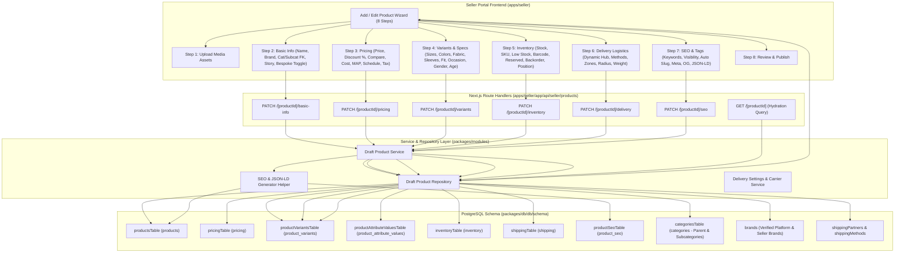

# Needlon Seller Platform: Product Listing Frontend & Architecture Implementation Plan

## 1. Executive Summary & Objective

This document defines the complete, step-by-step implementation blueprint to re-architect and align the **Product Listing Wizard** in the Needlon Seller Portal (`apps/seller` & `packages/modules/modules/products`). 

The redesign resolves historical data structure discrepancies, establishes strict relational constraints across the catalog and delivery domains, eliminates data drift bugs (such as round-trip discount percentage distortion and unselected fit attributes), removes schema duplicates, replaces manual text inputs with dynamic operational configurations, and automates SEO metadata generation.

---

## 2. End-to-End Architectural Architecture & Data Flow



---

## 3. Section-by-Section Deep Dive Analysis & Specifications

### Section 1: Upload Media Assets / Photos
- **Current Status**: Implemented in [upload-photos-n-videos-node.tsx](file:///d:/web%20development/project/needlon_sellor-main/needlon_sellor-main/packages/modules/modules/products/section/upload-photos-n-videos-node.tsx). Backed by [productImagesTable](file:///d:/web%20development/project/needlon_sellor-main/needlon_sellor-main/packages/db/db/schema/catalog/products/product-images/table.ts).
- **Required Action**: **No UI changes required**. Retain drag-and-drop, multi-asset uploading, thumbnail selection, reordering, and removal.
- **Integration Touchpoint**: Ensure the primary thumbnail (`isPrimary = true`) automatically cascades into Section 7 for Open Graph (`ogImage`), Twitter Cards (`twitterImage`), and Google Rich Results structured data.

---

### Section 2: Basic Information Section
- **Current Flaws**:
  1. `subcategory` is stored as free-form string concatenated into `products.short_description` (e.g. `Brand: X | Subcategory: Y`).
  2. Subcategories are not linked to the relational `categories` table.
  3. Brand name is purely raw unvalidated text; verified platform brands in `brands` table cannot be selected.
- **Target Functional & Relational Architecture**:
  1. **Product Name** (`products.name`): Required, trimmed, max length 255.
  2. **Brand Selector** (`products.brand_id` & `products.brand_name`):
     - **Dual-mode interface**: Seller can pick an existing verified brand from `brands` schema (where `is_verified = true` or `seller_id = currentSeller.id`), or enter a custom artisanal brand name.
     - `brand_id`: Foreign key UUID referencing `brands(id)` with `ON DELETE SET NULL`.
     - `brand_name`: String column storing custom or display brand label.
  3. **Category** (`products.category_id`):
     - Foreign key UUID referencing `categories(id)` where `parent_id IS NULL` (root/top-level category, e.g., "Mens Wear", "Women Wear").
  4. **Subcategory** (`products.subcategory_id`):
     - Add `subcategory_id` foreign key UUID to `productsTable` referencing `categories(id)` where `parent_id = products.category_id`.
     - Frontend sends the subcategory `id` (UUID), **never raw text**.
     - Selecting a parent category dynamically loads child categories via `GET /api/seller/products/categories?parentId={categoryId}`.
  5. **Description Story** (`products.description`):
     - Full artisanal story, weave specifications, and craftsman background.
  6. **Bespoke Customization Option** (`products.is_customizable`):
     - Boolean toggle enabled (`true`) by default per [SAAS_BESPOKE_PLATFORM_SPEC.md](file:///d:/web%20development/project/needlon_sellor-main/needlon_sellor-main/docs/SAAS_BESPOKE_PLATFORM_SPEC.md).
     - **Pre-Order Flexibility**: Can be switched off before orders are received for standard Ready-to-Wear (RTW) clothing.
     - **Post-Order Lock**: If active orders exist for this item (`hasExistingOrders = true`), disable toggle and show the lock badge.

---

### Section 3: Pricing Section
- **Current Flaws**:
  1. **Discount Rate Drift Bug**: `discountOfferRate` is stored as transient state. In the backend, `compareAtPrice` is calculated as `price * (1 + rate/100)`. When reading back, the rate is recalculated as `((compareAtPrice - price) / compareAtPrice) * 100`. Because of the disparate formulas (markup vs margin) and decimal truncation, the discount percentage changes automatically on every edit save!
  2. Missing UI fields: `currencyCode`, `costPrice`, `minimumAdvertisedPrice`, `effectiveFrom`, `effectiveUntil`, `isTaxInclusive`, `metadata`, `createdBy`, `updatedBy`.
- **Target Functional & Relational Architecture**:
  1. **Pricing Schema Updates (`pricingTable`)**:
     - Add dedicated `discountRate`: `numeric("discount_rate", { precision: 5, scale: 2 })` (persisted directly, eliminating recalculation drift).
     - Ensure existing columns are populated: `price`, `compareAtPrice`, `costPrice`, `minimumAdvertisedPrice`, `currencyCode` (default `'INR'`), `effectiveFrom`, `effectiveUntil`, `isTaxInclusive`, `metadata`, `createdBy`, `updatedBy`.
  2. **Discount Calculation Fix**:
     - When seller inputs `price` (e.g., 800) and `discountRate` (e.g., 20%), calculate `compareAtPrice = price / (1 - discountRate/100)` (e.g., 1000 MRP).
     - Or when seller inputs `price` (800) and `compareAtPrice` (1000), calculate `discountRate = ((compareAtPrice - price) / compareAtPrice) * 100` = 20.00%.
     - Both `discountRate` and `compareAtPrice` are saved directly to `pricingTable`. On re-edit, `discountRate` is read directly from the table, guaranteeing 100% stability.
  3. **UI Additions (`pricing-system-node.tsx`)**:
     - Currency Type selector (INR ₹, USD $, EUR €, GBP £).
     - Retail Selling Price (Customer payable amount).
     - Discount Offer Rate (%) with live calculation of Strike-Through MRP / Compare At Price.
     - Internal Cost Price (Internal procurement/tailor cost - marked with badge: "Internal only, hidden from buyers").
     - Minimum Advertised Price (MAP - optional compliance price floor).
     - Promotional Schedule: `Effective From` and `Effective Until` (date-time selectors).
     - Tax Inclusivity Switch: `Is Tax Inclusive` (default: `true`).
     - Optional Metadata / Notes.
  4. **Audit Fields**:
     - `createdBy` and `updatedBy` are automatically populated with the authenticated seller's `seller.id`.

---

### Section 4: Variant Section
- **Current Flaws**:
  1. `sizesMatrix` and `colorsTrack` are combined into a single text string in `product_variants.variant_name` and parsed with fragile string splitting.
  2. **Fit Type Disappearance Bug**: The `<select>` element in `variants-matrix-node.tsx` displays the first option visually while `formData.fitType` starts as `""`. If the user does not change the dropdown, empty string `""` is submitted, failing DB persistence. On re-edit, the value is missing.
  3. Occasion Focus, Gender Profile, and Target Age Group are present in the frontend UI but lost or unpersisted because category attributes are missing or inconsistently queried.
  4. Attributes use ad-hoc text values rather than standard typed database columns (`value_number`, `value_boolean`, `value_date`, `value_json`, `display_value`).
- **Target Functional & Relational Architecture**:
  1. **Separation of Sizes and Colors**:
     - Sizes are stored as variant-level options via [productVariantOptionsTable](file:///d:/web%20development/project/needlon_sellor-main/needlon_sellor-main/packages/db/db/schema/catalog/products/product-variant-options/table.ts) linking to the verified "Size" attribute and its option ID.
     - Colors are stored distinctly, either as separate variant options or dedicated attribute values with foreign keys (`attributeId`, `attributeOptionId`) referencing `category_attributes` and `category_attribute_options`.
  2. **Fixing the Fit Type Vanishing Bug**:
     - Add default placeholder `<option value="">Select Fit Type...</option>` in the select dropdown and provide a valid default state in `DEFAULT_FORM_DATA`.
     - Seed canonical attributes (`fit`, `fabric`, `sleeves`, `occasion`, `gender`, `age_group`) in `categoryAttributesTable` linked to category hierarchies so lookups never fail.
  3. **Proper Use of `product_attribute_values` Schema**:
     - Ensure the following columns in [productAttributeValuesTable](file:///d:/web%20development/project/needlon_sellor-main/needlon_sellor-main/packages/db/db/schema/catalog/products/product-attribute-values/table.ts) are actively utilized:
       - `value_text`: String attributes (e.g. Fabric Material, Sleeve Style).
       - `value_number`: Numeric specifications (e.g. Fabric GSM, Thread Count).
       - `value_boolean`: Boolean flags (e.g. Stretchable: `true`/`false`, Pre-Shrunk: `true`/`false`).
       - `value_date`: Dates (e.g. Manufacturing / Batch Date).
       - `value_json`: Structured attributes (e.g. Care Instructions, Weave Nuances).
       - `display_value`: Formatted customer-facing text (e.g. "220 GSM", "Pure Linen").
       - `metadata`: JSONB metadata for extra attributes.
       - `created_by` / `updated_by`: Authenticated `seller.id`.
     - Store **true Foreign Key UUIDs** (`attribute_id`, `attribute_option_id`), ensuring database integrity.
  4. **Persisting Occasion, Gender & Age Group**:
     - Explicitly map `occasionFocus`, `genderProfile`, and `targetAgeGroup` into `product_attribute_values` and hydrate them in `getProductById`.

---

### Section 5: Inventory Section
- **Current Flaws**:
  1. `reserved_quantity`, `last_adjusted_at`, and `position` are absent from the frontend UI and unvalidated on update.
  2. **Duplicate Schema Columns**: In `productVariantsTable`, the fields `price`, `compareAtPrice`, and `costPrice` are duplicated from `pricingTable`, risking split-brain pricing discrepancies.
- **Target Functional & Relational Architecture**:
  1. **Remove Duplicate Fields from `productVariantsTable`**:
     - Deprecate and remove `price`, `compareAtPrice`, and `costPrice` from `productVariantsTable`.
     - Refactor any legacy queries across the monorepo to join `pricingTable` on `pricing.variant_id = product_variants.id`.
  2. **Frontend Inventory UI Additions (`inventry-level-node.tsx`)**:
     - `Boutique Stock Count` (`inventory.quantity`): Integer $\ge 0$.
     - `Unique SKU` (`product_variants.sku`): Validated alphanumeric string, auto-generatable with standard pattern `NDLN-{CAT}-{SUBCAT}-{RAND}`.
     - `Low Stock Threshold` (`inventory.low_stock_threshold`): Alert trigger quantity.
     - `Barcode / EAN / UPC` (`product_variants.barcode`): Optional universal code.
     - `Reserved Quantity` (`inventory.reserved_quantity`): Quantity allocated to ongoing orders/alterations. Read-only display with explanatory badge or editable by inventory managers.
     - `Allow Backorders When Out of Stock` (`inventory.allow_backorder`): Boolean toggle.
     - `Last Adjusted At` (`inventory.last_adjusted_at`): Timestamp display reflecting the last inventory change.
     - `Variant Catalog Position` (`product_variants.position`): Numeric sorting index for prioritizing display on the storefront.

---

### Section 6: Delivery Section
- **Current Flaws**:
  1. All delivery fields (`pickupHubAddress`, `packageWeight`, `deliveryRadiusRange`, `estimatedDeliveryWindow`) are manual free-text strings with zero verification.
  2. Delivery parameters are not linked to the delivery schemas (`shippingPartners`, `shippingMethods`, `shipmentOrders`, seller pickup hubs, shipping zones).
  3. `packageWeight` and `estimatedDeliveryWindow` are stored in untyped metadata rather than the structured variant/shipping schema.
- **Target Functional & Relational Architecture**:
  1. **Schema Linkage & Storage**:
     - Store `weight_grams` (or `package_weight`) and `estimated_delivery_window` directly on `product_variants` (or dedicated columns on `shippingTable`).
     - Associate the product with shipping methods through `product_shipping_methods` or `shippingTable.shipping_class`.
  2. **Dynamic UI Replacement (`delivery-logistics-node.tsx`)**:
     - **Pickup Hub Location**: Dynamic `<select>` populated from seller's verified warehouses/ateliers fetched from `GET /api/seller/delivery/settings` (`pickupHub`).
     - **Shipping Methods & Partners**: Dynamic selector populated from active shipping carriers (`shippingPartners` and `shippingMethods`), e.g. FedEx Standard, Shiprocket Air, Local Fleet.
     - **Delivery Zones**: Dynamic selector populated from seller's configured shipping zones (Domestic, International, Local Metro).
     - **Delivery Radius & Local Delivery**: Populated from configured local radius settings (e.g. "Within 15 km - Same Day Dispatch").
     - **Package Weight & Dimensions**:
       - Structured numeric weight input with unit selector (`kg` / `grams`).
       - Optional length, width, height inputs in centimeters for volumetric weight calculations.
     - **Estimated Delivery Window**:
       - Dynamically calculated from selected `shippingMethods.estimatedMinDays` and `estimatedMaxDays` (e.g., "2 - 4 business days"), with optional manual override for customized bespoke creations requiring tailored lead times (e.g. "7 - 10 business days for tailoring + 2 days transit").
  3. **Storefront Linkage**: When buyers browse and order products on `apps/client`, the checkout shipping calculations use the real carrier methods, pickup origin, weight, and delivery timeline.

---

### Section 7: SEO Optimization & Search Tags Section
- **Current Flaws**:
  1. Only basic search keywords and a visibility dropdown are present.
  2. Slug generation is not standardized.
  3. Crucial SEO assets—Meta Title, Meta Description, Meta Keywords, Canonical URL, Open Graph (OG) tags, Twitter Card tags, and Schema.org JSON-LD—are not systematically generated or displayed for seller review.
- **Target Functional & Relational Architecture**:
  1. **Fields in `productSeoTable`**:
     - `slug`: SEO-friendly unique URL slug (e.g. `handloom-chikankari-silk-kurti`).
     - `metaTitle`: Title tag (e.g. `Handloom Chikankari Silk Kurti | House of Needlon`).
     - `metaDescription`: Meta description (truncated 150-160 chars from description story).
     - `metaKeywords`: String array derived from search keywords, taxonomy, and tags.
     - `canonicalUrl`: Standard canonical link `https://needlon.com/products/${slug}`.
     - `ogTitle`, `ogDescription`, `ogImage`: Open Graph cards for social sharing.
     - `twitterTitle`, `twitterDescription`, `twitterImage`: Twitter summary card data.
     - `structuredData`: Valid Schema.org `Product` JSON-LD object with name, image, description, offers, and brand.
     - `metadata`: Reserved JSONB field.
     - `createdBy` and `updatedBy`: Authenticated seller UUID.
  2. **Automated SEO Generator Helper (`packages/modules/modules/products/lib/seo-generator.ts`)**:
     - Pure helper function that ingests the product's Basic Info, Pricing, Media, and Tags to generate all SEO and Open Graph fields automatically.
     - Runs on the fly on Step 7, allowing sellers to inspect and edit before publishing.
  3. **Frontend UI Enhancements (`seo-n-tags-node.tsx`)**:
     - **Search Keywords / Tags**: Interactive tag input with quick suggestion pills.
     - **Storefront Visibility**: Public, Private (Hidden Catalog), Unlisted (Direct link only).
     - **Live SERP & Social Preview Card**:
       - Google Search Result Snippet (Meta Title, Slug/URL, Meta Description).
       - Social Share Card Preview (OG Image, OG Title, Description).
     - **Canonical URL Display**: Auto-generated preview with copy button.
     - **Regenerate SEO Button**: Re-runs the generator if product name or pricing changes.

---

## 4. Database Schema Changes & Migration Specification

### Summary of Schema Modifications

| Table | File Location | Changes Required |
| :--- | :--- | :--- |
| `products` | `packages/db/db/schema/catalog/products/table.ts` | 1. Add `subcategoryId: uuid("subcategory_id").references(() => categoriesTable.id)`<br>2. Add `brandId: uuid("brand_id").references(() => brands.id)`<br>3. Add `brandName: varchar("brand_name", { length: 150 })`<br>4. Stop saving `Brand:` and `Subcategory:` into `shortDescription`. |
| `pricing` | `packages/db/db/schema/catalog/products/pricing/table.ts` | 1. Add `discountRate: numeric("discount_rate", { precision: 5, scale: 2 })`<br>2. Ensure `createdBy` and `updatedBy` are mapped to seller ID. |
| `product_variants` | `packages/db/db/schema/catalog/products/product-variants/table.ts` | 1. **Remove duplicate fields**: `price`, `compareAtPrice`, `costPrice`<br>2. Add `estimatedDeliveryWindow: varchar("estimated_delivery_window", { length: 100 })`<br>3. Confirm `weightGrams` and `position` are active. |
| `inventory` | `packages/db/db/schema/catalog/products/inventory/table.ts` | Confirm `reservedQuantity`, `lastAdjustedAt`, `lowStockThreshold`, and `allowBackorder` are exposed in DTOs and API routes. |
| `product_seo` | `packages/db/db/schema/catalog/products/product-seo/table.ts` | Ensure all fields (`canonicalUrl`, `og*`, `twitter*`, `structuredData`, `metaKeywords`) are populated by the SEO generator service. |
| `category_attributes` | `packages/db/db/schema/catalog/category-attributes/table.ts` | Ensure standard garment attributes (`fabric`, `sleeves`, `fit`, `occasion`, `gender`, `age_group`) have predefined attribute definitions and options. |

### Drizzle Migration SQL Blueprint (`migrations/xxxx_refactor_product_listing_schema.sql`)

```sql
-- 1. Products Schema Updates
ALTER TABLE "products" 
ADD COLUMN IF NOT EXISTS "subcategory_id" UUID REFERENCES "categories"("id") ON DELETE RESTRICT,
ADD COLUMN IF NOT EXISTS "brand_id" UUID REFERENCES "brands"("id") ON DELETE SET NULL,
ADD COLUMN IF NOT EXISTS "brand_name" VARCHAR(150);

CREATE INDEX IF NOT EXISTS "products_subcategory_idx" ON "products"("subcategory_id");
CREATE INDEX IF NOT EXISTS "products_brand_idx" ON "products"("brand_id");

-- 2. Pricing Schema Updates
ALTER TABLE "pricing"
ADD COLUMN IF NOT EXISTS "discount_rate" NUMERIC(5, 2) DEFAULT 0.00;

-- 3. Product Variants Schema Updates
-- Migrate any remaining prices to pricing table before dropping
INSERT INTO "pricing" ("id", "variant_id", "price", "compare_at_price", "cost_price", "currency_code", "created_at", "updated_at")
SELECT gen_random_uuid(), pv.id, COALESCE(pv.price::numeric, 0.00), pv.compare_at_price::numeric, pv.cost_price::numeric, 'INR', now(), now()
FROM "product_variants" pv
WHERE NOT EXISTS (SELECT 1 FROM "pricing" p WHERE p.variant_id = pv.id)
ON CONFLICT ("variant_id") DO NOTHING;

ALTER TABLE "product_variants"
DROP COLUMN IF EXISTS "price",
DROP COLUMN IF EXISTS "compare_at_price",
DROP COLUMN IF EXISTS "cost_price",
ADD COLUMN IF NOT EXISTS "estimated_delivery_window" VARCHAR(100);

-- 4. Inventory Schema Updates
ALTER TABLE "inventory"
ALTER COLUMN "reserved_quantity" SET DEFAULT 0,
ALTER COLUMN "last_adjusted_at" SET DEFAULT now();
```

---

## 5. Step-by-Step Implementation Roadmap

### Phase 1: Database Schema & Migration Execution
- **Step 1.1**: Update `packages/db/db/schema/catalog/products/table.ts` to include `subcategoryId`, `brandId`, and `brandName`.
- **Step 1.2**: Update `packages/db/db/schema/catalog/products/pricing/table.ts` to add `discountRate`.
- **Step 1.3**: Update `packages/db/db/schema/catalog/products/product-variants/table.ts` to add `estimatedDeliveryWindow` and remove `price`, `compareAtPrice`, and `costPrice`.
- **Step 1.4**: Run `pnpm db:generate` and execute migrations. Verify foreign keys and indexes.

### Phase 2: DTOs & Zod Validation Schemas
- **Step 2.1**: Refactor `packages/modules/modules/products/validations/basic-info.schema.ts`:
  ```ts
  export const updateBasicInfoSchema = z.object({
    name: z.string().trim().min(2).max(255),
    brandId: z.string().uuid().optional().nullable(),
    brandName: z.string().trim().max(150).optional().nullable(),
    categoryId: z.string().uuid(),
    subcategoryId: z.string().uuid().optional().nullable(),
    descriptionStory: z.string().trim().optional(),
    isCustomizable: z.boolean().default(true),
  });
  ```
- **Step 2.2**: Refactor `packages/modules/modules/products/validations/pricing.schema.ts`:
  ```ts
  export const updatePricingSchema = z.object({
    retailPrice: z.string().or(z.number()),
    discountOfferRate: z.string().or(z.number()).optional(),
    currencyCode: z.string().default("INR"),
    compareAtPrice: z.string().or(z.number()).optional().nullable(),
    costPrice: z.string().or(z.number()).optional().nullable(),
    minimumAdvertisedPrice: z.string().or(z.number()).optional().nullable(),
    effectiveFrom: z.string().datetime().optional().nullable(),
    effectiveUntil: z.string().datetime().optional().nullable(),
    isTaxInclusive: z.boolean().default(true),
    metadata: z.record(z.unknown()).optional(),
  });
  ```
- **Step 2.3**: Refactor `packages/modules/modules/products/validations/variants.schema.ts`:
  - Validate discrete size list, color list, and attribute values (`fabricMaterial`, `sleevesStyle`, `fitType`, `occasionFocus`, `genderProfile`, `targetAgeGroup`).
  - Validate dynamic typed attribute payloads (`valueText`, `valueNumber`, `valueBoolean`, `valueDate`, `valueJson`, `displayValue`).
- **Step 2.4**: Refactor `packages/modules/modules/products/validations/inventory.schema.ts`:
  ```ts
  export const updateInventorySchema = z.object({
    boutiqueStockCount: z.coerce.number().int().min(0),
    uniqueSku: z.string().trim().min(1),
    lowStockThreshold: z.coerce.number().int().min(0).default(5),
    barcode: z.string().trim().optional().nullable(),
    reservedQuantity: z.coerce.number().int().min(0).default(0),
    allowBackorder: z.boolean().default(false),
    position: z.coerce.number().int().default(0),
  });
  ```
- **Step 2.5**: Refactor `packages/modules/modules/products/validations/delivery.schema.ts`:
  ```ts
  export const updateDeliverySchema = z.object({
    pickupHubId: z.string().uuid().optional(),
    pickupHubAddress: z.string().optional(),
    shippingPartnerId: z.string().uuid().optional(),
    shippingMethodId: z.string().uuid().optional(),
    deliveryZone: z.string().optional(),
    deliveryRadiusKm: z.coerce.number().optional(),
    packageWeightKg: z.coerce.number().positive(),
    packageLengthCm: z.coerce.number().positive().optional(),
    packageWidthCm: z.coerce.number().positive().optional(),
    packageHeightCm: z.coerce.number().positive().optional(),
    estimatedDeliveryWindow: z.string().min(1),
  });
  ```

### Phase 3: SEO Helper & Business Logic Libraries
- **Step 3.1**: Create `packages/modules/modules/products/lib/seo-generator.ts`:
  - Slug generator: converts name + artisan tags to sanitized kebab-case with uniqueness check.
  - Generates `metaTitle`, `metaDescription`, `canonicalUrl` (`https://needlon.com/products/${slug}`).
  - Generates OpenGraph and Twitter cards using the primary media image.
  - Builds Schema.org `Product` JSON-LD object.
- **Step 3.2**: Refactor `draft-product.repository.ts`:
  - Update `updateDraftProductBasicInfo` to persist `categoryId`, `subcategoryId`, `brandId`, and `brandName`.
  - Update `updateDraftProductPricing` to store `discountRate` directly and fix round-trip calculations.
  - Update `updateDraftProductVariants` to save foreign-key constrained attributes into `product_attribute_values` and split sizes/colors cleanly.
  - Update `updateDraftProductInventory` to store `reservedQuantity`, `lastAdjustedAt`, and `position`.
  - Update `updateDraftProductDelivery` to persist weight and delivery window to `product_variants` and `shipping`.
  - Update `updateDraftProductSeo` to save all canonical SEO fields and structured data.
- **Step 3.3**: Update `getProductById.ts` to return the complete hydrated data structure without parsing hacks or missing attributes.

### Phase 4: API Routes & Endpoints
- **Step 4.1**: `GET /api/seller/products/categories`:
  - Returns hierarchical categories: root categories and child subcategories (`id, name, slug, parentId`).
- **Step 4.2**: `GET /api/seller/brands`:
  - Returns verified platform brands and the seller's custom brands.
- **Step 4.3**: `GET /api/seller/delivery/options`:
  - Aggregates active shipping partners, methods, pickup hubs, and delivery zones for dropdown consumption.
- **Step 4.4**: Update PATCH route handlers for `basic-info`, `pricing`, `variants`, `inventory`, `delivery`, and `seo`.

### Phase 5: Hook & Form State Management (`useAddProductWizard`)
- **Step 5.1**: Update `DEFAULT_FORM_DATA` in `constants.ts` with all new fields.
- **Step 5.2**: Update `useAddProductWizardInternal` in `use-add-product-wizard.ts`:
  - Manage `categoryId` and `subcategoryId` UUID states.
  - Manage brand selection state (verified brand ID vs custom name).
  - Manage dynamic delivery options state (pickup hubs, carriers, zones).
  - Manage complete pricing state (`currencyCode`, `costPrice`, `minimumAdvertisedPrice`, `effectiveFrom`, `effectiveUntil`, `isTaxInclusive`).
  - Maintain the live SEO preview state.

### Phase 6: Frontend UI Components Redesign
- **Step 6.1**: Refactor `basic-information-node.tsx`:
  - Brand selector: Select verified brand or toggle custom artisanal brand input.
  - Category selector: Passes `categoryId` UUID.
  - Subcategory selector: Dynamically filtered by `parentId === selectedCategoryId`, sending `subcategoryId` UUID.
  - Bespoke Customization switch with active order lock.
- **Step 6.2**: Refactor `pricing-system-node.tsx`:
  - Currency selector, Price, Discount Rate, Strike-Through MRP, Cost Price, MAP, Effective Dates, Tax Inclusive switch.
- **Step 6.3**: Refactor `variants-matrix-node.tsx`:
  - Sizing interactive pills (separate from colors).
  - Colors track interactive selector.
  - Fit Type select with explicit placeholder `<option value="">Select Fit Type...</option>` to fix the unselected/vanishing bug.
  - Sleeve, Fabric, Occasion, Gender, and Age Group selectors mapped to DB attributes.
- **Step 6.4**: Refactor `inventry-level-node.tsx`:
  - Boutique Stock, Unique SKU (with generator), Low Stock Threshold, Barcode.
  - Add Reserved Quantity card, Allow Backorder switch, Last Adjusted At badge, Catalog Position input.
- **Step 6.5**: Refactor `delivery-logistics-node.tsx`:
  - Replace raw text with dynamic dropdowns: Pickup Hub, Shipping Method, Delivery Zone, Local Delivery Radius.
  - Package weight & dimensions input.
  - Calculated / Selectable Estimated Delivery Window.
- **Step 6.6**: Refactor `seo-n-tags-node.tsx`:
  - Search keywords with tag pills.
  - Custom visibility settings.
  - Live Google Search & Social Media card preview.
  - Canonical URL preview with one-click regenerate.

### Phase 7: Validation, Testing & Backwards Compatibility
- **Step 7.1**: Write automated unit and integration tests in `packages/modules/modules/products/products.test.ts` covering:
  - Subcategory foreign key assignment.
  - Brand selection (verified vs custom).
  - Discount percentage stability over 10 consecutive edits without mathematical drift.
  - Fit Type selection persistence after re-fetching.
  - Inventory reserved count and backorder updates.
  - Dynamic shipping method and hub assignment.
  - Automated SEO slug, Open Graph, and JSON-LD generation.
- **Step 7.2**: Verify that existing products without the new fields migrate cleanly with fallback defaults.

---

## 6. Frontend UI Mockup Specifications (Tailwind & Design System)

All UI elements strictly adhere to Needlon's design tokens:
- **Surfaces**: `bg-neutral-50`, `hover:bg-neutral-100`, focus to `bg-white`
- **Borders**: `border-neutral-200/60`, focus to `focus:border-neutral-900`
- **Typography**: Text labels `text-[11px] font-bold text-neutral-400 uppercase tracking-wider`
- **Inputs**: `rounded-xl p-3 text-[13px] outline-none transition-all`
- **Badges**: `rounded-full text-[10px] font-bold`

### 6.1 Basic Information Section Mockup (`basic-information-node.tsx`)
```tsx
<div className="grid grid-cols-1 sm:grid-cols-2 gap-4">
  {/* Product Name */}
  <div className="flex flex-col gap-1.5">
    <label className="text-[11px] font-bold text-neutral-400 uppercase tracking-wider">Product Name *</label>
    <input
      type="text"
      placeholder="e.g. Handloom Chanderi Silk Kurti"
      value={formData.name}
      onChange={(e) => handleInputChange('name', e.target.value)}
      className="w-full p-3 bg-neutral-50 border border-neutral-200/60 rounded-xl text-[13px] outline-none focus:bg-white focus:border-neutral-900"
    />
  </div>

  {/* Brand Selector (Hybrid Verified vs Custom) */}
  <div className="flex flex-col gap-1.5">
    <div className="flex items-center justify-between">
      <label className="text-[11px] font-bold text-neutral-400 uppercase tracking-wider">Brand Label</label>
      <button
        type="button"
        onClick={() => setIsCustomBrand(!isCustomBrand)}
        className="text-[10px] text-neutral-500 hover:text-neutral-900 underline"
      >
        {isCustomBrand ? "Select Verified Brand" : "+ Enter Custom Brand"}
      </button>
    </div>
    {isCustomBrand ? (
      <input
        type="text"
        placeholder="Enter custom artisanal brand name..."
        value={formData.brandName}
        onChange={(e) => handleInputChange('brandName', e.target.value)}
        className="w-full p-3 bg-neutral-50 border border-neutral-200/60 rounded-xl text-[13px] outline-none focus:bg-white focus:border-neutral-900"
      />
    ) : (
      <select
        value={formData.brandId || ""}
        onChange={(e) => handleInputChange('brandId', e.target.value)}
        className="w-full p-3 bg-neutral-50 border border-neutral-200/60 rounded-xl text-[13px] outline-none cursor-pointer"
      >
        <option value="">Select Verified Brand...</option>
        {verifiedBrands.map(b => (
          <option key={b.id} value={b.id}>{b.name} (Verified)</option>
        ))}
      </select>
    )}
  </div>

  {/* Cascading Category & Subcategory */}
  <div className="flex flex-col gap-1.5">
    <label className="text-[11px] font-bold text-neutral-400 uppercase tracking-wider">Category *</label>
    <select
      value={formData.categoryId}
      onChange={(e) => handleCategoryChange(e.target.value)}
      className="w-full p-3 bg-neutral-50 border border-neutral-200/60 rounded-xl text-[13px] outline-none cursor-pointer"
    >
      <option value="">Select Primary Category...</option>
      {categories.map(cat => (
        <option key={cat.id} value={cat.id}>{cat.name}</option>
      ))}
    </select>
  </div>

  <div className="flex flex-col gap-1.5">
    <label className="text-[11px] font-bold text-neutral-400 uppercase tracking-wider">Subcategory *</label>
    <select
      value={formData.subcategoryId}
      disabled={!formData.categoryId || availableSubcategories.length === 0}
      onChange={(e) => handleInputChange('subcategoryId', e.target.value)}
      className="w-full p-3 bg-neutral-50 border border-neutral-200/60 rounded-xl text-[13px] outline-none cursor-pointer disabled:opacity-50"
    >
      <option value="">Select Subcategory...</option>
      {availableSubcategories.map(sub => (
        <option key={sub.id} value={sub.id}>{sub.name}</option>
      ))}
    </select>
  </div>
</div>
```

### 6.2 Pricing Valuation Section Mockup (`pricing-system-node.tsx`)
```tsx
<div className="grid grid-cols-1 sm:grid-cols-3 gap-4">
  {/* Currency */}
  <div className="flex flex-col gap-1.5">
    <label className="text-[11px] font-bold text-neutral-400 uppercase tracking-wider">Currency</label>
    <select
      value={formData.currencyCode}
      onChange={(e) => handleInputChange('currencyCode', e.target.value)}
      className="w-full p-3 bg-neutral-50 border border-neutral-200/60 rounded-xl text-[13px] outline-none cursor-pointer font-bold"
    >
      <option value="INR">INR (₹)</option>
      <option value="USD">USD ($)</option>
      <option value="EUR">EUR (€)</option>
    </select>
  </div>

  {/* Retail Selling Price */}
  <div className="flex flex-col gap-1.5">
    <label className="text-[11px] font-bold text-neutral-400 uppercase tracking-wider">Retail Price *</label>
    <input
      type="number"
      placeholder="₹2,450"
      value={formData.retailPrice}
      onChange={(e) => handlePriceChange(e.target.value)}
      className="w-full p-3 bg-neutral-50 border border-neutral-200/60 rounded-xl text-[13px] outline-none font-medium"
    />
  </div>

  {/* Discount Offer Rate (%) */}
  <div className="flex flex-col gap-1.5">
    <label className="text-[11px] font-bold text-neutral-400 uppercase tracking-wider">Discount Rate (%)</label>
    <input
      type="number"
      min="0"
      max="99"
      placeholder="20%"
      value={formData.discountOfferRate}
      onChange={(e) => handleDiscountChange(e.target.value)}
      className="w-full p-3 bg-neutral-50 border border-neutral-200/60 rounded-xl text-[13px] outline-none font-medium"
    />
  </div>

  {/* Compare At Price (MRP) */}
  <div className="flex flex-col gap-1.5">
    <label className="text-[11px] font-bold text-neutral-400 uppercase tracking-wider">Compare At Price (MRP)</label>
    <input
      type="number"
      placeholder="₹3,060"
      value={formData.compareAtPrice}
      onChange={(e) => handleComparePriceChange(e.target.value)}
      className="w-full p-3 bg-neutral-50 border border-neutral-200/60 rounded-xl text-[13px] outline-none font-medium"
    />
  </div>

  {/* Cost Price */}
  <div className="flex flex-col gap-1.5">
    <div className="flex items-center gap-1.5">
      <label className="text-[11px] font-bold text-neutral-400 uppercase tracking-wider">Internal Cost</label>
      <span className="text-[9px] bg-neutral-200 text-neutral-600 px-1.5 py-0.5 rounded">Private</span>
    </div>
    <input
      type="number"
      placeholder="₹1,200"
      value={formData.costPrice}
      onChange={(e) => handleInputChange('costPrice', e.target.value)}
      className="w-full p-3 bg-neutral-50 border border-neutral-200/60 rounded-xl text-[13px] outline-none"
    />
  </div>

  {/* Minimum Advertised Price */}
  <div className="flex flex-col gap-1.5">
    <label className="text-[11px] font-bold text-neutral-400 uppercase tracking-wider">Min Advertised Price (MAP)</label>
    <input
      type="number"
      placeholder="Optional floor price"
      value={formData.minimumAdvertisedPrice}
      onChange={(e) => handleInputChange('minimumAdvertisedPrice', e.target.value)}
      className="w-full p-3 bg-neutral-50 border border-neutral-200/60 rounded-xl text-[13px] outline-none"
    />
  </div>

  {/* Promotional Schedule: Effective Dates */}
  <div className="flex flex-col gap-1.5">
    <label className="text-[11px] font-bold text-neutral-400 uppercase tracking-wider">Effective From</label>
    <input
      type="datetime-local"
      value={formData.effectiveFrom || ""}
      onChange={(e) => handleInputChange('effectiveFrom', e.target.value)}
      className="w-full p-3 bg-neutral-50 border border-neutral-200/60 rounded-xl text-[12px] outline-none"
    />
  </div>

  <div className="flex flex-col gap-1.5">
    <label className="text-[11px] font-bold text-neutral-400 uppercase tracking-wider">Effective Until</label>
    <input
      type="datetime-local"
      value={formData.effectiveUntil || ""}
      onChange={(e) => handleInputChange('effectiveUntil', e.target.value)}
      className="w-full p-3 bg-neutral-50 border border-neutral-200/60 rounded-xl text-[12px] outline-none"
    />
  </div>

  {/* Tax Inclusivity */}
  <div className="sm:col-span-3 flex items-center justify-between p-3.5 bg-neutral-50 border border-neutral-200/60 rounded-xl mt-1">
    <div className="flex flex-col">
      <span className="text-[13px] font-semibold text-neutral-900">Price is Inclusive of Applicable Taxes (GST)</span>
      <span className="text-[11px] text-neutral-400">Retail price already includes customer-facing sales tax.</span>
    </div>
    <input
      type="checkbox"
      checked={formData.isTaxInclusive}
      onChange={(e) => handleInputChange('isTaxInclusive', e.target.checked)}
      className="h-4 w-4 rounded border-neutral-300 text-neutral-900"
    />
  </div>
</div>
```

### 6.3 Delivery Section Mockup (`delivery-logistics-node.tsx`)
```tsx
<div className="grid grid-cols-1 sm:grid-cols-2 gap-4">
  {/* Verified Pickup Hub Dropdown */}
  <div className="sm:col-span-2 flex flex-col gap-1.5">
    <label className="text-[11px] font-bold text-neutral-400 uppercase tracking-wider">Pickup Warehouse / Atelier Hub *</label>
    <select
      value={formData.pickupHubId}
      onChange={(e) => handleInputChange('pickupHubId', e.target.value)}
      className="w-full p-3 bg-neutral-50 border border-neutral-200/60 rounded-xl text-[13px] outline-none cursor-pointer"
    >
      <option value="">Select Verified Pickup Hub...</option>
      {pickupHubs.map(hub => (
        <option key={hub.id} value={hub.id}>{hub.hubName} — {hub.city}, {hub.pincode}</option>
      ))}
    </select>
  </div>

  {/* Shipping Method / Carrier */}
  <div className="flex flex-col gap-1.5">
    <label className="text-[11px] font-bold text-neutral-400 uppercase tracking-wider">Shipping Method & Carrier *</label>
    <select
      value={formData.shippingMethodId}
      onChange={(e) => handleShippingMethodChange(e.target.value)}
      className="w-full p-3 bg-neutral-50 border border-neutral-200/60 rounded-xl text-[13px] outline-none cursor-pointer"
    >
      <option value="">Select Shipping Method...</option>
      {shippingMethods.map(m => (
        <option key={m.id} value={m.id}>{m.partnerName} - {m.methodName} ({m.estimatedMinDays}-{m.estimatedMaxDays} Days)</option>
      ))}
    </select>
  </div>

  {/* Delivery Zone */}
  <div className="flex flex-col gap-1.5">
    <label className="text-[11px] font-bold text-neutral-400 uppercase tracking-wider">Shipping Zone</label>
    <select
      value={formData.deliveryZone}
      onChange={(e) => handleInputChange('deliveryZone', e.target.value)}
      className="w-full p-3 bg-neutral-50 border border-neutral-200/60 rounded-xl text-[13px] outline-none cursor-pointer"
    >
      <option value="DOMESTIC">Domestic (All States)</option>
      <option value="LOCAL_EXPRESS">Local Metro Express (Within Radius)</option>
      <option value="INTERNATIONAL">International (Global Courier)</option>
    </select>
  </div>

  {/* Package Weight */}
  <div className="flex flex-col gap-1.5">
    <label className="text-[11px] font-bold text-neutral-400 uppercase tracking-wider">Package Weight (kg) *</label>
    <input
      type="number"
      step="0.01"
      placeholder="e.g. 0.45"
      value={formData.packageWeightKg}
      onChange={(e) => handleInputChange('packageWeightKg', e.target.value)}
      className="w-full p-3 bg-neutral-50 border border-neutral-200/60 rounded-xl text-[13px] outline-none"
    />
  </div>

  {/* Estimated Delivery Window */}
  <div className="flex flex-col gap-1.5">
    <label className="text-[11px] font-bold text-neutral-400 uppercase tracking-wider">Estimated Delivery Window</label>
    <input
      type="text"
      readOnly
      value={formData.estimatedDeliveryWindow}
      className="w-full p-3 bg-neutral-100 border border-neutral-200/60 rounded-xl text-[13px] text-neutral-700 font-medium"
    />
  </div>
</div>
```

### 6.4 SEO & Tags Section Mockup (`seo-n-tags-node.tsx`)
```tsx
<div className="flex flex-col gap-5">
  <div className="grid grid-cols-1 gap-4">
    {/* Tags */}
    <div className="flex flex-col gap-1.5">
      <label className="text-[11px] font-bold text-neutral-400 uppercase tracking-wider">Search Keywords / Tags</label>
      <input
        type="text"
        placeholder="e.g. handloom, chikankari, silk kurti, festive wear"
        value={formData.searchKeywords}
        onChange={(e) => handleInputChange('searchKeywords', e.target.value)}
        className="w-full p-3 bg-neutral-50 border border-neutral-200/60 rounded-xl text-[13px] outline-none"
      />
    </div>

    {/* Custom Visibility */}
    <div className="flex flex-col gap-1.5">
      <label className="text-[11px] font-bold text-neutral-400 uppercase tracking-wider">Visibility Setting</label>
      <select
        value={formData.customVisibility}
        onChange={(e) => handleInputChange('customVisibility', e.target.value)}
        className="w-full p-3 bg-neutral-50 border border-neutral-200/60 rounded-xl text-[13px] outline-none font-bold"
      >
        <option value="PUBLIC">PUBLIC — Visible in search and storefront</option>
        <option value="PRIVATE">PRIVATE — Hidden from public catalog</option>
        <option value="UNLISTED">UNLISTED — Accessible only via direct link</option>
      </select>
    </div>
  </div>

  {/* Live SERP Snippet Preview */}
  <div className="p-4 bg-white border border-neutral-200 rounded-xl shadow-xs">
    <div className="flex items-center justify-between mb-2">
      <span className="text-[11px] font-bold text-neutral-500 uppercase tracking-wider">Google Search Snippet Preview</span>
      <button type="button" onClick={handleRegenerateSeo} className="text-[11px] font-bold text-neutral-700 hover:underline">
        Auto-Regenerate from Details
      </button>
    </div>
    <div className="text-[11px] text-neutral-500 truncate">{`https://needlon.com/products/${formData.slug || 'product-slug'}`}</div>
    <div className="text-[16px] font-medium text-blue-800 hover:underline cursor-pointer truncate">
      {formData.metaTitle || `${formData.name || 'Product Title'} | Needlon`}
    </div>
    <div className="text-[12px] text-neutral-600 line-clamp-2 mt-0.5">
      {formData.metaDescription || formData.descriptionStory?.slice(0, 160) || "Artisanal handcrafted garment..."}
    </div>
  </div>
</div>
```

---

## 7. Verification & Automated Test Strategy

To guarantee zero regressions and strict adherence to the project guidelines, the following validation test suite will be executed in `packages/modules/modules/products/products.test.ts`:

1. **Subcategory Relational Integrity Test**:
   - Create parent category "Mens Wear" (`parentId: null`).
   - Create child category "Kurta" (`parentId: MensWear.id`).
   - Create product with `categoryId: MensWear.id`, `subcategoryId: Kurta.id`.
   - Validate foreign key constraints reject random non-existent UUIDs.
2. **Brand Selector Verification Test**:
   - Seed verified platform brand "Needlon Atelier" in `brands` table.
   - Assert product linked with `brandId` successfully hydrates brand logo and verification badge.
   - Test fallback to custom artisanal brand when `brandId` is null and `brandName` is populated.
3. **Discount Rate Edit Stability Test (Zero-Drift Validation)**:
   - Save product with Price = 800, Discount Rate = 20.00% (`compareAtPrice` = 1000).
   - Simulate 10 consecutive edits updating non-pricing fields (e.g. stock, tags, description).
   - Assert `discountRate` remains strictly `20.00` and `price` remains `800.00` across all 10 saves.
4. **Fit Type Hydration & Edit Persistence Test**:
   - Save product with `fitType: "Straight Regular Fit"`.
   - Call `getProductByIdService`.
   - Assert `data.fitType === "Straight Regular Fit"`.
   - Open wizard and submit next step without touching fit dropdown.
   - Assert `product_attribute_values` retains `Straight Regular Fit`.
5. **Variant Schema Deduplication Test**:
   - Inspect table metadata for `product_variants`.
   - Assert columns `price`, `compare_at_price`, and `cost_price` are omitted.
   - Assert all pricing reads execute against `pricingTable`.
6. **Dynamic Delivery Mapping Test**:
   - Create test pickup hub and shipping method ("FedEx Standard", 2-4 days).
   - Save product with selected method ID.
   - Query client-facing product summary and assert estimated delivery window displays "2 - 4 business days" based on method parameters.
7. **Automated SEO & JSON-LD Generation Test**:
   - Create product with title "Handloom Chikankari Silk Kurti" and price 2450.
   - Run SEO generation pipeline.
   - Assert `product_seo.slug` = `handloom-chikankari-silk-kurti`.
   - Assert `product_seo.canonical_url` = `https://needlon.com/products/handloom-chikankari-silk-kurti`.
   - Assert `product_seo.structured_data` contains valid Schema.org `@type: "Product"` with matched offer and image.

---

## 8. Summary Checklist for Implementation

- [ ] **Step 1: Upload Media Assets**: Confirm no changes required in UI; verify media URL pass-through to SEO previews.
- [ ] **Step 2: Basic Information**:
  - [ ] Add `subcategoryId`, `brandId`, `brandName` columns to `productsTable`.
  - [ ] Convert subcategory dropdown from raw text to dynamic category child entity using foreign keys.
  - [ ] Implement dual-mode brand input (verified brand picker or custom name).
  - [ ] Retain bespoke customization toggle with active order lock.
- [ ] **Step 3: Pricing System**:
  - [ ] Add `discountRate` column to `pricingTable`.
  - [ ] Fix discount calculation to eliminate round-trip edit value drift.
  - [ ] Add UI inputs for currency, compare-at, cost price, MAP, schedule dates, and tax inclusiveness.
  - [ ] Populate `createdBy` and `updatedBy` with authenticated seller ID.
- [ ] **Step 4: Boutique Variants**:
  - [ ] Decouple size matrix and color tracking into distinct relational variant options.
  - [ ] Fix fit type unselected/vanishing bug with proper placeholder and state initialization.
  - [ ] Persist occasion focus, gender profile, and age group into `product_attribute_values`.
  - [ ] Utilize typed attribute columns (`value_text`, `value_number`, `value_boolean`, etc.) with foreign keys.
- [ ] **Step 5: Inventory & Allocation**:
  - [ ] Add UI fields for reserved quantity, last adjusted at, and variant position.
  - [ ] Drop redundant `price`, `compareAtPrice`, and `costPrice` columns from `product_variants`.
  - [ ] Redirect all variant price queries across monorepo to `pricingTable`.
- [ ] **Step 6: Delivery Logistics**:
  - [ ] Replace manual text inputs with dynamic selectors for pickup hubs, shipping carriers, and delivery zones.
  - [ ] Store package weight and delivery window on variant schema.
  - [ ] Ensure buyer checkout calculates live delivery windows from linked shipping methods.
- [ ] **Step 7: SEO Optimization & Tags**:
  - [ ] Build automated SEO helper function for slug, meta tags, Open Graph, Twitter cards, and Schema.org JSON-LD.
  - [ ] Formulate standard canonical URL (`https://needlon.com/products/${slug}`).
  - [ ] Add live SERP and social preview card in the frontend wizard.
- [ ] **Step 8: Automated Verification**:
  - [ ] Execute `products.test.ts` testing subcategory FKs, zero-drift discount preservation, and SEO generation.
